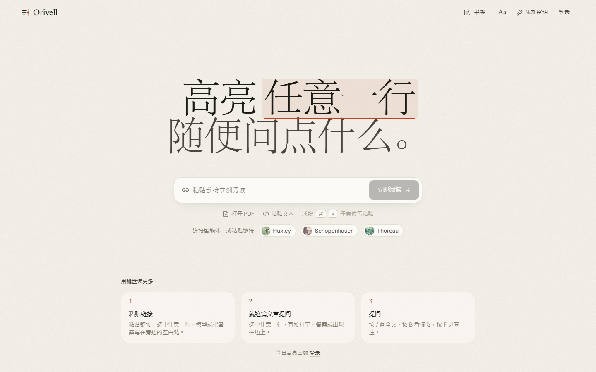
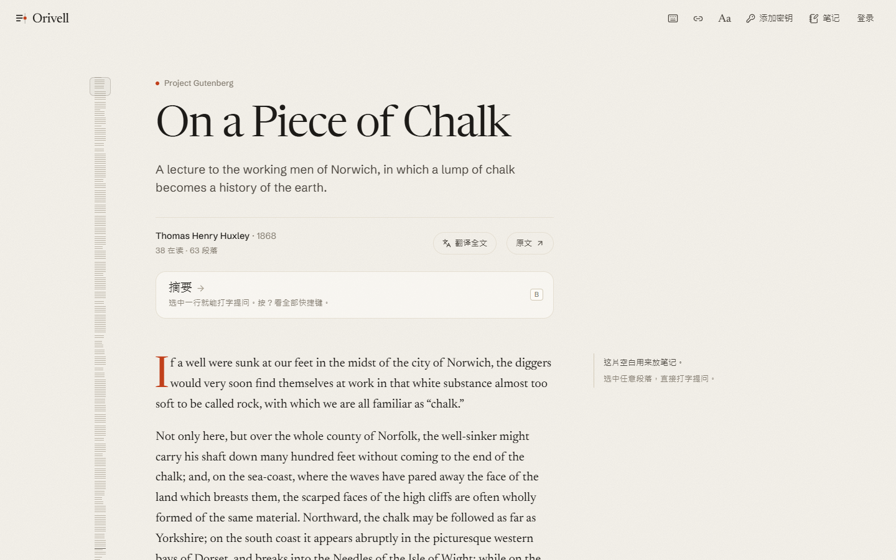

<p align="center">
  
</p>

<h1 align="center">Orivell</h1>

<p align="center">
  中文优先的个人阅读库。粘贴链接、PDF 或一段文字，划住任意一句提问，答案写在页边的空白处。<br>
  Fork 自 <a href="https://github.com/Nutlope/gloss">Nutlope/gloss</a>，重做了中文界面、账号体系、翻译与知识图谱。
</p>

<p align="center">
  <a href="#功能">功能</a> ·
  <a href="#快速开始">快速开始</a> ·
  <a href="#环境变量">环境变量</a> ·
  <a href="#目录结构">目录结构</a> ·
  <a href="#与上游-gloss-的差异">与上游差异</a>
</p>

---

## 这是什么

一个跑在自己机器上的阅读器。它把网页、PDF、纯文本变成一页干净的排版，右边留一条空白的页边：
你划住一段，打字提问，模型把答案写在那段旁边，并标注它引用了原文的哪些句子。答案不是聊天气泡，
是批注——所以读完之后，你留下的是写满了笔记的一本书，不是一段滚走了的对话。

所有内容先写进浏览器的 localStorage，登录后再同步到自己的 Postgres。没有账号也能用，只是换设备要重来。

<table>
  <tr>
    <td width="50%"><br><sub><b>书架</b>　按主题摆放，也能自建书架、按最近/颜色/长度排</sub></td>
    <td width="50%"><br><sub><b>阅读器</b>　左边正文，右边页边；摘要、翻译、朗读都在同一屏</sub></td>
  </tr>
</table>

## 功能

**读**

- 三种入口：粘贴链接抓正文、打开本地 PDF、直接粘贴一段文字
- PDF 在浏览器里解析（`liteparse` WASM，文件不出本机）；扫描版或难解析的页面可走 `pdf-careful`（可接 LlamaParse）
- 划词提问：选住任意一句，答案以批注形式写在该段右侧，带原文引用；追问也留在这条批注里
- 按 `/` 问整篇，按 `B` 看摘要，按 `F` 进专注模式
- 划词翻译 + 全篇逐段翻译（三种排版可选），原文/译文随时切
- 朗读（TTS）、字号字体与纸色（纸/棕/雪/夜）切换

**整理**

- 书架以"书脊"呈现，按主题归架；支持自建书架、按主题/最近/颜色/长度排列
- 主题与封面自动抓取，重复条目会提示合并
- 今日高亮回顾：每天回看你划过的地方

**图谱**

- 从文章里抽实体（人、机构、概念），按共现建图，Louvain 划分社群
- 视图：星系图 / 实体目录 / 邻域 / 引用 / 同作者
- 语义相关推荐（需要 embeddings 表；没建则静默跳过，其余信号照常）

**同步与账号**

- localStorage 优先，登录后与 Neon Postgres 同步；删除走墓碑，不会把别的设备上的副本"复活"
- 自建账号：邮箱 + 密码（scrypt 加盐哈希，session cookie 只存 token 哈希），找回密码走服务端重置
- Clerk 仍保留为可选登录方式，不配也能全站可用

**接入**

- Agent 接入：签发 MCP token，让 Claude / ChatGPT / Grok 直接把链接放进你的书架（`/mcp/<token>`）
- X（Twitter）书签批量导入
- 国内平台（公众号、小红书一类有登录墙的）可选接 MediaCrawler sidecar
- Tauri 2 安卓壳，手机上是同一个应用（见 `ANDROID-DEMO.md`）

## 快速开始

要求 Node 22+（用到 Node 的类型擦除直接跑 `.ts`），以及一个 Postgres（推荐 [Neon](https://neon.tech) 免费库）。

```bash
git clone https://github.com/llylly10/orivell-reader
cd orivell-reader
npm install
cp .env.example .env.local     # 按下一节填值
npm run db:migrate             # 建表，幂等，可重复跑
npm run dev                    # http://127.0.0.1:3100
```

> 必须用 `127.0.0.1` 或 `localhost` 访问。用别的地址打开时 Next 会拦掉 HMR 的跨域 socket，页面会失去热更新，登录页也可能白屏（`next.config.ts` 的 `allowedDevOrigins`）。

不配任何 key 也能启动：书架里的三篇公有领域样文（Huxley / Schopenhauer / Thoreau）可以直接读，只是提问会提示你先添加密钥。

## 环境变量

| 变量 | 必填 | 作用 |
| --- | --- | --- |
| `DATABASE_URL` | 是 | Neon 的 Postgres 连接串。同步、账号、图谱都靠它 |
| `AI_BASE_URL` | 是 | 任意 OpenAI 兼容端点，例如 `https://api.deepseek.com/v1`、`https://open.bigmodel.cn/api/paas/v4`、本地 `http://127.0.0.1:11434/v1` |
| `AI_API_KEY` | 是 | 上面那个端点的 key |
| `AI_MODEL` | 是 | 模型名，如 `deepseek-chat`、`glm-4.7-flash`。默认走快速档，够用且便宜 |
| `TOGETHER_API_KEY` | 否 | 官方 Together 通道。设了 `AI_BASE_URL` 时服务端请求走自己的端点；访客自贴的 key 仍走 Together |
| `NEXT_PUBLIC_SITE_URL` | 否 | 站点公开地址，用于 canonical 与分享卡片，默认 `http://localhost:3100` |
| `NEXT_PUBLIC_SYNC_INTERVAL_MS` | 否 | 书架轮询同步的间隔，默认 5000。多人共用一个库时调大（30000）省查询 |
| `CLERK_SECRET_KEY` / `NEXT_PUBLIC_CLERK_PUBLISHABLE_KEY` | 否 | 想用 Clerk 登录时才需要；不配走自建邮箱账号 |
| `EXA_API_KEY` | 否 | 联网问答与事实核查。不配则答案只在原文范围内 |
| `RESEND_API_KEY` / `RESEND_FROM` | 否 | 找回密码邮件。不配则走服务端手动重置 |
| `CRON_SECRET` | 否 | 保护每日回顾的定时接口 |
| `AI_VISION_*` / `AI_IMAGE_*` | 否 | 扫描页看图、封面图生成，不配则跳过 |
| `GLOSS_CNSPIDER_URL` | 否 | MediaCrawler sidecar 地址，默认 `http://127.0.0.1:8899` |

## 常用命令

| 命令 | 作用 |
| --- | --- |
| `npm run dev` | 开发服务器，端口 3100 |
| `npm run build` / `npm start` | 生产构建 / 启动 |
| `npm run lint` | 类型检查（`tsc --noEmit`，本仓库没有 ESLint） |
| `npm test` | 单元测试（`node --test`，当前覆盖书架与链接解析） |
| `npm run db:migrate` | 建表，幂等 |
| `npm run db:check` / `db:verify` | 连通性检查 / 结构校验 |
| `npm run db:import-x` | 导入 X 书签 |
| `npm run db:measure*` | 存储、流量、查询开销的实测脚本 |

## 目录结构

```
app/                 页面与 API 路由
  page.tsx           首页：粘贴链接 / 打开 PDF / 粘贴文字
  library/           书架
  read/[id]/         阅读器
  graph/             知识图谱
  api/               ask、brief、translate-article、speak、sync、graph、
                     shelve、covers、duplicates、import、auth、cron/daily-review…
  mcp/[token]/       Agent 接入端点
components/
  reader/            正文、页边（Margin）、批注块、选区与锚点
  library/ graph/ landing/ account/ ui/ brand/
lib/
  store.ts sync.ts   本地状态与跨设备同步（改之前先读文件头注释）
  anchor.ts          划词锚点的坐标格式，横跨阅读器、导出、复习、MCP
  db.ts              Neon HTTP 驱动，表名只从 COLLECTIONS 白名单来
  auth.ts session.ts 自建账号与会话
  together.ts models.ts 模型调用与可选模型表
  i18n.ts            en / zh 两套文案，en 是源，zh 缺的键回退英文
  graph 相关         apply-entities / classify-all / louvain 脚本在 scripts/
db/schema.sql        同步的表结构（jsonb + 墓碑）
content/             三篇公有领域样文
scripts/             迁移、导入、审计、端到端验证
tests/               node --test
src-tauri/           Tauri 2 安卓壳
docs/                数据库接入、登录接入、账号方案，以及 README 用的截图
```

## 数据与同步

内容主要活在浏览器里，`gloss:v1` 是书架与删除台账，`gloss:sync:*` 是同步游标。两条不变式：

1. **墓碑只来自"这台设备确实从自己书架上移除过"的行**——由 `persistShelf()` 写盘前后的书架差集产生，不存在别的来源。
2. **拉取窗口有 30 秒重叠**，所以远端可能反复送来你已经删掉的旧副本；`applyRemote()` 不许把台账里的行加回书架。

这两条破了不会报错，只会静默丢数据或复活已删文章。改同步链路前请先读 `lib/sync.ts`、`lib/store.ts` 的文件头注释，并跑完 `npx tsc --noEmit && npm test` 再用真实浏览器验证。

## 已知限制

- **没有 LICENSE**。仓库目前不附带任何许可证，按默认版权规则，你可以读、但不能再分发或复用。
- 中文文案覆盖了主要界面，少数深层设置项仍回退英文。
- 语义相关推荐依赖 embeddings 表，默认不建，所以这一路信号是静默跳过的。
- 国内平台抓取的 sidecar 路径写死在本机（`D:/shujia/MediaCrawler`），公开仓库里开箱不可用。
- 安卓壳是演示级：直连演示服务，未做离线缓存与应用商店签名流程。
- 没有 CI。测试与类型检查靠本地手动跑。

## 文档

- [`docs/数据库接入与账号收尾.md`](docs/数据库接入与账号收尾.md)　Neon 建库、迁移、账号数据收尾
- [`docs/登录功能接入说明.md`](docs/登录功能接入说明.md)　登录、语言切换的前端接线
- [`docs/账号系统自建方案.md`](docs/账号系统自建方案.md)　用自建邮箱账号替代 Clerk 的方案
- [`ANDROID-DEMO.md`](ANDROID-DEMO.md)　安卓打包、演示服务器、踩过的四个坑

## 致谢

上游是 [Nutlope/gloss](https://github.com/Nutlope/gloss)（[usegloss.io](https://usegloss.io)）：页边批注的交互、锚点格式、书架动画都来自那里，这一版在它的骨架上做了中文化与本地化改造。样文来自 Project Gutenberg，属公有领域。
